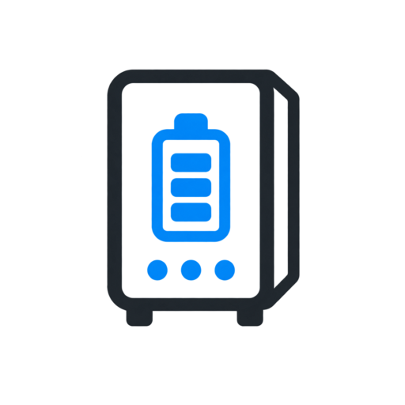

# Stark SolarPower for Home Assistant

> Beta candidate: **1.9.11-beta007** / UI **0.9.11-beta004**. The Overview shows every discovered UPS in a list of taller cards, alongside the original five tabs. The device selector is available on all other tabs.



Custom Home Assistant integration for **STARK Country Online** UPS devices monitored through the SolarPower / ShineMonitor cloud backend.

## Status

Current production baseline: **v1.9.10** with the integration-owned UPS panel UI **v0.9.8**.

The integration has been field-tested on two STARK Country Online 1000 VA UPS devices with SolarPower Wi-Fi cards.

## Features

- Cloud polling every 60 seconds.
- Read-only operation: the integration does not send UPS control or configuration commands.
- Automatic device discovery from the SolarPower account.
- Stable device identity based on Wi-Fi module PN.
- Input/output voltage and frequency.
- Output current and load.
- Battery voltage and charge.
- Positive/negative DC bus voltage and four internal temperature channels.
- Optional vendor RAW battery/runtime and internal power-stage/relay diagnostics from the detailed SolarPower endpoint.
- Operating mode and on-battery state.
- Cloud telemetry availability.
- UPS data timestamp and data age.
- Stale-data protection: operational entities become unavailable when cloud data is too old.
- Transition event entities for battery mode, explicit Fault Mode, cloud telemetry, data freshness and optional extended-telemetry health.
- Integration-owned mobile-first UPS panel at `/dashboard-ups`.
- Manual **Refresh all UPS** button.
- HTTPS transport when supported by the SolarPower endpoint.
- Detailed SolarPower telemetry is normally sampled every 5 minutes; while a UPS reports Battery Mode it is sampled every 60 seconds so remaining runtime follows the physical display.
- Failed detailed telemetry is retried on the next normal 60-second coordinator pass.
- Diagnostics retain the full normalized detailed field set with credentials and tokens excluded.

## Integration-owned UPS panel

The integration ships its own dedicated Home Assistant panel.

Navigation contract:

- route: `/dashboard-ups`;
- owner: `stark_solarpower`;
- sidebar title: `ИБП Stark`;
- icon: `mdi:battery-charging`;
- preferred view: `overview`;
- panel UI version: `0.9.11-beta004`;
- product artwork: `Stark Country 1000 ONLINE (16A)`.

Views:

- **Обзор** — one card per UPS with independent cloud and freshness states, power mode, a load scale, battery voltage and charge, input and output voltages, and the vendor's runtime estimate. Expand **Подробнее** for the snapshot time and last successful exchange.
- **ИБП** — selected UPS working parameters.
- **События** — selected UPS recent events.
- **История** — selected UPS measurements linked to native Home Assistant history.
- **Диагн.** — selected UPS source and extended telemetry diagnostics.

The shared NikaS shell preserves its viewport, zoom and scroll position during telemetry updates. Overview values require both a confirmed cloud connection and fresh snapshot. Runtime availability additionally depends on the detailed SolarPower endpoint.

The panel never calls the Stark/SolarPower API directly. It reads Home Assistant entities only and uses the existing integration button entity for manual refresh. `unknown` and `unavailable` are never presented as healthy states.

See `docs/PANEL.md` for the UX contract, failure-state matrix and `ha-contract-generated-ui` hand-off metadata.

## Event model

The event layer is edge-triggered. It does not synthesize events from vendor RAW alarm-history fields and it does not replay a transition when Home Assistant starts.

Per UPS, the integration exposes event entities for:

- entering and leaving battery mode;
- entering and clearing the explicit `Fault Mode` operating state;
- primary cloud telemetry lost/restored;
- UPS data becoming stale/fresh using the 6-minute freshness threshold;
- extended telemetry lost/restored as an optional diagnostic event entity.

Home Assistant's current developer guidance favors event entities for integration events. This integration therefore does not add new legacy device-automation trigger APIs.

## Installation and updates with HACS

1. Open HACS in Home Assistant.
2. Add this repository as a custom repository:
   `https://github.com/NikaSir/ha-stark-solarpower`
3. Category: **Integration**.
4. Install **Stark SolarPower**.
5. Restart Home Assistant.
6. Go to **Settings → Devices & services → Add integration** and search for **Stark SolarPower**.
7. Enter the SolarPower username and password when configuring the integration for the first time.

During active panel development, HACS follows the repository's default `main` branch; GitHub Releases are intentionally not used. For routine upgrades, update **Stark SolarPower** from HACS and restart Home Assistant when requested. Do not remove the Home Assistant config entry during normal upgrades. Manual ZIP installation is retained only as an emergency recovery path.

## Manual installation

Copy:

```text
custom_components/stark_solarpower/
```

to:

```text
/config/custom_components/stark_solarpower/
```

and restart Home Assistant.

## Data freshness model

SolarPower cloud updates can lag the physical UPS by roughly 2–3 minutes. The integration therefore distinguishes between:

- successful cloud communication;
- the timestamp of the actual UPS data snapshot;
- the calculated age of that snapshot;
- the slower detailed-telemetry endpoint.

The default primary stale threshold is **360 seconds (6 minutes)**. When data is stale, operational values are intentionally marked unavailable instead of presenting old measurements as current.

Primary telemetry is normally polled every 60 seconds. After a cloud request fails, retries for the affected UPS are spaced at 60, 120, 240, then at most 300 seconds until communication returns. A UPS last seen in Battery Mode keeps 60-second retry attempts. A manual refresh bypasses the retry delay. The first failure produces a warning; subsequent failures are logged at debug level, and recovery is logged once. During an outage, the UPS remains unavailable and old detailed values are not used as current data; recovery refreshes detailed telemetry before merging it again.

Detailed telemetry is intentionally sampled every 5 minutes. If the latest detailed request for one UPS fails, cached detailed values remain in diagnostics but are not merged into live entities. The integration retries the detailed request on the next normal 60-second pass.

## Validated detailed fields

On both field UPS devices, the following were confirmed:

- protocol ID `PI01`;
- battery piece count `2`;
- positive and negative DC bus voltages;
- UPS, PFC, ambient and charger temperature channels;
- vendor `Open` / `Closed` values for DC-DC, PFC, inverter, input relay and output relay.

The vendor field named `Battery Group NNumber` contains values that differ between the two otherwise similar UPS devices. It is therefore exposed only as **vendor RAW** diagnostics, not as a physical group count. The integration preserves the vendor's misspelled raw key and also provides a stable internal alias so entity unique IDs do not depend on that typo.

`Battery Remain Time` stays available as vendor RAW for diagnostics. The panel displays it as an estimate in hours and minutes using the existing minute interpretation. Device-display comparison remains a field acceptance check.

`Fault Kind` and the associated pre-fault snapshot are retained only in diagnostics. `Fault Kind = 14` was observed while both UPS devices were operating normally, so it must not be interpreted as an active alarm.

## Security

- Passwords, API tokens, account secrets and private diagnostic payloads must never be committed to this repository.
- The integration is read-only.
- HTTPS is preferred automatically; compatibility fallback is retained for the SolarPower backend if required.

## License

MIT
